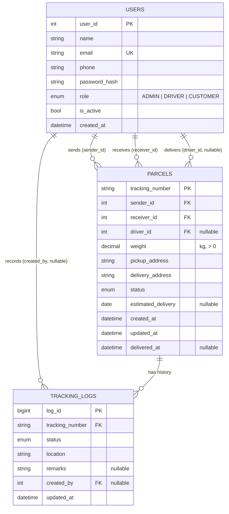

# Entity-Relationship Diagram

Three entities. `users` plays three roles in `parcels` (sender, receiver, driver),
and `tracking_logs` records the append-only history of each shipment.

## Cardinality

| Relationship | Cardinality | Notes |
| --- | --- | --- |
| user → sent parcels | 1 : N | required (`sender_id` NOT NULL) |
| user → received parcels | 1 : N | required (`receiver_id` NOT NULL) |
| user → assigned parcels | 1 : N | optional; a parcel may await assignment |
| parcel → tracking events | 1 : N | at least one (`CREATED`); cascade delete |
| user → tracking events authored | 1 : N | optional for system-generated events |

## Normalisation

- **1NF** – every column is atomic; addresses are single free-text values.
- **2NF** – all non-key columns depend on the whole primary key
  (`tracking_number` for parcels, `log_id` for logs).
- **3NF** – no transitive dependencies: user details live only in `users`, and
  a log references its parcel by key instead of copying parcel attributes.
  The obvious exception is the intentional denormalisation of `status` on
  `parcels` (current state, needed for fast filtering) while `tracking_logs`
  holds the history.

## Constraints that encode business rules

| Rule | Enforcement |
| --- | --- |
| Email uniqueness (case-insensitive) | unique index + lowercased value in service |
| Weight must be positive | `CHECK (weight > 0)` |
| Only known statuses/roles | `CHECK` on enumerated string columns |
| History cannot outlive its parcel | `ON DELETE CASCADE` from logs to parcels |
| Users with parcel history cannot be deleted | `ON DELETE RESTRICT` + service check |
| Legal status transitions | application state machine (see `app/models/enums.py`) |

## Index rationale

| Index | Supports |
| --- | --- |
| `uq_users_email` | login lookup and duplicate detection |
| `ix_parcels_status` | dashboard status breakdown, admin filters |
| `ix_parcels_sender_status` | customer "my shipments" filtered by status |
| `ix_parcels_receiver_status` | incoming shipment list |
| `ix_parcels_driver_status` | driver work queue |
| `ix_tracking_logs_parcel_time` | shipment timeline in chronological order |
